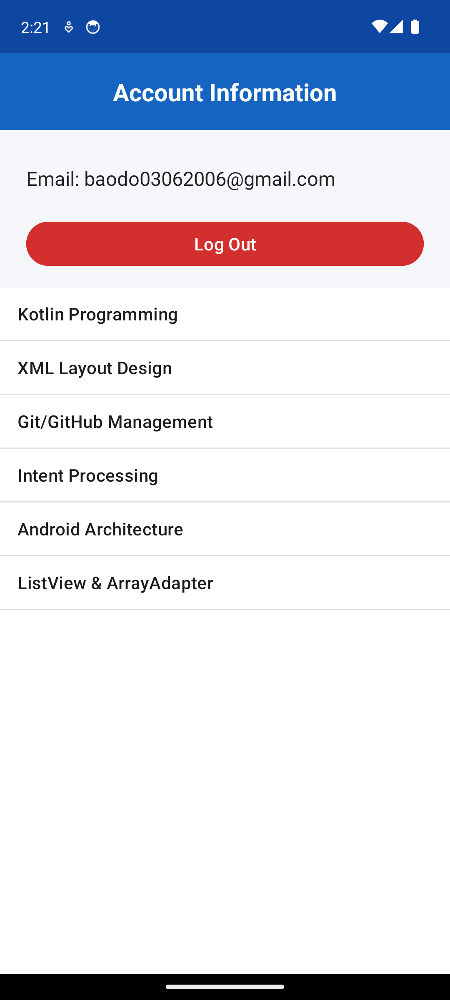
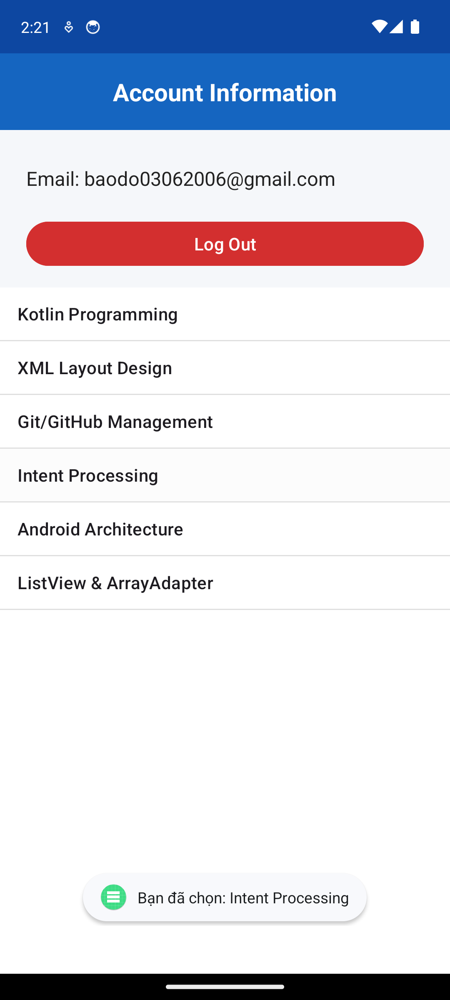

# KiemTra_LapTrinhUngDungDiDong_2474802015084
Repository bài kiểm tra thực hành môn Lập trình ứng dụng di động
# BÀI THI THỰC HÀNH - CÂU 3
- **Họ và tên:** Đỗ Quốc Bảo
- **MSSV:** 2474802015084
- **Tên dự án:** KiemTra_LapTrinhUngDungDiDong_2474802015084

---

## Minh chứng Câu 1
### 1. Thông báo lỗi khi dữ liệu không hợp lệ

### 2. Xác thực thành công khi dữ liệu hợp lệ

## Minh chứng Câu 2

## Minh chứng Câu 3
### 1. Giao diện hiển thị danh sách ListView

### 2. Thông báo Toast khi click vào phần tử

